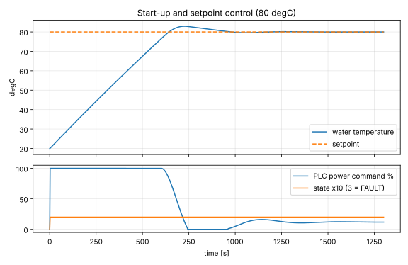
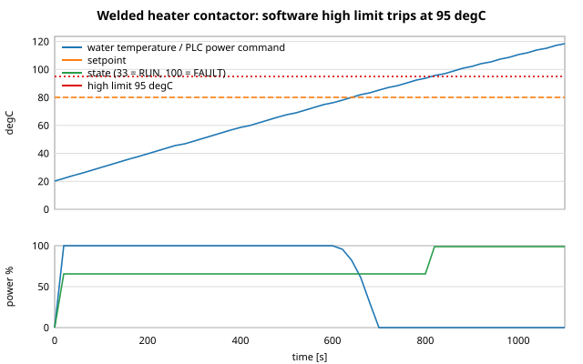

# Boiler Controller in IEC 61131-3 Structured Text

A controller for a hot-water boiler, written in IEC 61131-3 Structured Text (the normal PLC / SPS language) and tested in a closed loop against a simulated boiler. I compile the ST program to C with the open-source [MATIEC](https://github.com/beremiz/matiec) compiler and run it from Python one PLC scan (100 ms) at a time. That way every behaviour below has an automated test.



## What the program does

- **Sequence:** `OFF -> PUMP_START -> RUN`, and any alarm goes to `FAULT` (CASE state machine).
- **Temperature control:** PI controller with anti-windup (conditional integration), output 0–100 %.
- **Flow check:** the pump has to confirm within 5 s after the command. If the feedback is lost in RUN, it trips after 3 s.
- **High temperature limit:** trips at 95 °C and latches. It can only be reset below 85 °C (hysteresis).
- **Sensor plausibility:** open or short circuit (below -10 or above 200 °C) gives an alarm and switches the heater off.
- **Emergency stop:** NC chain, drops pump and heater immediately.
- **Setpoint limit:** the operator setpoint is clamped to 30–90 °C.
- **Pump after-run:** in FAULT the pump keeps running above 60 °C to get the heat out (but not if the pump itself is the fault).

## Results (simulation)

| Scenario | Result |
|---|---|
| Start-up 20 -> 80 °C | overshoot 2.9 K, within ±1 K after ~890 s |
| 5 kW load step | setpoint held within 1.5 K, controller output goes up |
| Setpoint entered as 150 °C | clamped to 90 °C, high limit never trips |
| Pump stops while running | `AlmNoFlow` after 3.2 s, heater off |
| Heater contactor welded shut | high limit trips at 95.0 °C, alarm stays latched until reset |



All of these come from the simulation, not from a real boiler.

## Run it

```bash
# 1. build MATIEC once (needs gcc, make, bison, flex, autoconf, automake)
git clone https://github.com/beremiz/matiec && cd matiec && autoreconf -i && ./configure && make && cd ..
# 2. compile the ST program to C, build the library and run the 13 tests
make MATIEC=/path/to/matiec test
make MATIEC=/path/to/matiec plots     # makes docs/*.svg again
```

## Run it in CODESYS (soft PLC)

1. New project, *Standard project*, device *CODESYS Control Win V3 (soft PLC)*.
2. Add a POU called `BoilerCtrl`, type *Program*, language *ST*.
3. Copy the `VAR_INPUT / VAR_OUTPUT / VAR` blocks from `src/boiler_ctrl.st` into the declaration part, and the code between the last `END_VAR` and `END_PROGRAM` into the body.
4. Call it from `PLC_PRG` or a 100 ms task, build, log in and force the inputs (`TempC`, `PumpRunning`, `EStopOK`, `StartCmd`, ...) to go through the sequence.

## Limits

- This is control and alarm logic, not a safety function. Real boiler safety limiters (STB, approved hardware, EN 12952/12953) work independently of the PLC.
- Tested against a simple first-order model, not against real hardware.
- The tuning (Kp = 10 %/K, Ki = 0.25 %/(K·s)) was chosen for this simulated plant.
